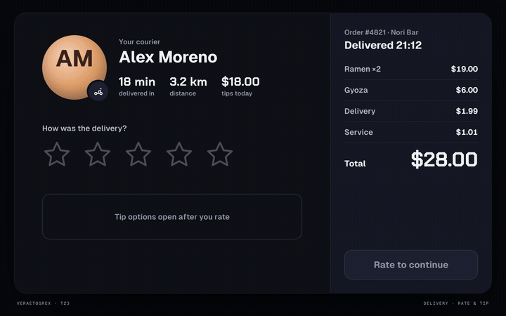

# Rate & Tip

**Five stars unlock the tip.**



**Live demo:** [veraetogrex-portfolio.github.io/rate-and-tip](https://veraetogrex-portfolio.github.io/rate-and-tip/) · **Mockup:** [full-screen version](https://veraetogrex-portfolio.github.io/rate-and-tip/mockup/rate-and-tip.html)

Rate the courier with one sweep across the stars; five stars open the tip options. Pick a tip and it slides into the order while the total rolls up. Send, and the button folds into a check, a ring closes around the courier and their tips for the day count up.

## Use it

Three files, no build step, no dependencies, no web fonts:

```
index.html   markup
style.css    styles and keyframes
script.js    behaviour
```

Download the repo and open `index.html`, or copy the three files into your project.

## Try it

- Press on the first star and sweep to the fifth, or click any star.
- Below five stars there is no tip step: the button just sends the rating.
- Stars and tip chips work with the keyboard (Tab, Enter / Space).

## Make it yours

`ORDER` and `TODAY` at the top of `script.js` set the order total and the courier's tips so far; the tip percentages are the `data-p` values on the chips in `index.html`, the order lines are plain HTML.

## What's in `mockup/`

The full 1440×900 screen this component was shot in for the reel:

- `mockup/rate-and-tip.html` — interactive. `D` plays the demo, `R` resets.
- `mockup/rate-and-tip.autoplay.html` — the scripted loop the reel was recorded from.
- URL flags: `?frame` puts the screen in a browser window, `?clean` hides the control panel, `?once` plays the demo once.

The mockup loads the same `style.css` and `script.js` from the root, plus a shared stage runtime and bundled fonts from `mockup/_shared/`. The component in the root doesn't need any of it.

---

Component 23 of a series. New one every day on Instagram [@veraetogrex_portfolio](https://www.instagram.com/veraetogrex_portfolio/) · all components: [github.com/veraetogrex-portfolio](https://github.com/veraetogrex-portfolio)

MIT licensed.
